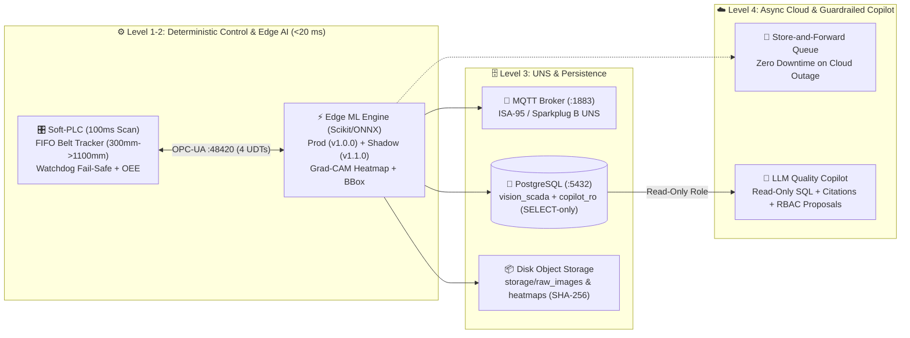

# 👁️‍🗨️ VisionSCADA AI Twin — Industrial Edge AOI, Soft-PLC, MLOps, UNS (ISA-95) & Ignition 8.3

An industrial-grade **Automated Optical Inspection (AOI) 3D Digital Twin & MLOps Platform** built outside cloud-synced folders (`C:\dev\VisionSCADA_AI_Twin`), combining a deterministic **Soft-PLC (`OPC-UA :48420`)**, **Edge ML Inference (`< 15 ms`)**, **Store-and-Forward Asynchronous Cloud Vision Auditing**, **PostgreSQL (`vision_scada`)**, **Unified Namespace (`ISA-95 / Sparkplug B MQTT :1883`)**, **SPC Attribute Control Chart (`Carta p` with Western Electric Rules)**, **Human-in-the-Loop (HITL) + Shadow Mode MLOps**, and a **Read-Only SQL Guardrailed LLM Copilot** integrated with **Ignition SCADA 8.3 Perspective**.

---

## 🏗️ System Architecture



---

## 🚀 Key Industrial Features

1. **Edge-First Deterministic Control vs. Cloud Async (*Store-and-Forward*)**:
   - The **Edge Model (`v1.0.0`)** classifies parts in **`~12–18 ms`** well inside the physical travel window (`~6.4 s` at 30 PPM) between the camera (`1300 mm`) and pneumatic reject cylinder (`4750 mm`).
   - If Edge inference exceeds `350 ms`, the **Soft-PLC Watchdog** triggers a fail-safe reject (`REJECT_WATCHDOG`) and raises a `CRITICAL` ISA-18.2 alarm.
   - Suspect or defective frames are queued asynchronously to the **Cloud Vision Auditor (`~850 ms`)** with full **Store-and-Forward buffering** if internet connectivity drops.
2. **Multi-Recipe Selector (3 Datasets = 3 Dynamic 3D Meshes + 6 Trained Models)**:
   - `CAST_100`: Pilot Technocast cast-iron impellers (`OK`, `Casting_Defect`). The public dataset is only good/defective.
   - `PACK_200`: PerceptiLabs Pill-Defects (`OK`, `Pill_Defect`). The public dataset is only normal/defect.
   - `PCB_300`: DeepPCB patches with real annotated defect types (`OK`, `Open`, `Short`, `Mousebite`, `Spur`, `Copper`, `Pin_Hole`).
3. **4 Ignition SCADA UDTs (`ignition/vision_scada_udts_and_tags.json`)**:
   - `UDT_ConveyorAxis`, `UDT_VisionCamera`, `UDT_RejectActuator`, `UDT_ProductionBatch`.
4. **SPC Carta $p$ + Western Electric Rules & ISA-18.2 Alarm Pipeline**:
   - Real-time subgroup calculation of $p_i$, $\bar{p}$, $\text{UCL} (3\sigma)$, and automatic evaluation of Western Electric rules (`RULE_1_3SIGMA`, `RULE_2_2OF3_2SIGMA`, `RULE_4_RUN_ABOVE_MEAN`).
5. **Closed-Loop MLOps (HITL, Shadow Mode, real PSI drift, MLflow + DVC)**: see [MLOps](#-mlops-reentrenamiento-desde-ignition-y-el-gemelo-3d) below.
6. **Guardrailed Read-Only SQL Copilot (`copilot_ro`)**:
   - Connects to PostgreSQL using a strictly `SELECT`-only database role, cites every SQL query executed, and emits RBAC-gated setpoint recommendations requiring human confirmation.

---

## 🧠 MLOps: reentrenamiento desde Ignition y el gemelo 3D

```
 gemelo 3D (/cell3d, tecla M)  ─┐                         ┌─► MLflow (:5000) runs, métricas, Model Registry
 Ignition Perspective /mlops   ─┼─► API /api/mlops/* ─► trainer ─┤   alias champion / challenger
 HITL (/api/mlops/feedback)    ─┘     imágenes nuevas      │      └─► DVC dvc add + push ─► MinIO s3://dvc-store
                                      storage/datasets/     └─► models/registry.json ─► edge recarga (SHADOW)
```

**Qué es real y qué no**

| Pieza | Estado |
|---|---|
| Edge ML (sklearn RF/GB sobre 18 features ópticas) | Real |
| Split train / test / holdout | Real: por hash SHA-256 del contenido (70/15/15). Una imagen nunca cae en dos splits; la producción del gemelo 3D usa solo el holdout |
| Etiquetas | CAST/PACK binarias (los datasets no traen subtipos). PCB con los 6 tipos reales de DeepPCB, recortes alrededor de cada defecto con su caja real |
| Drift PSI | Real: ventana móvil de 60 frames contra la referencia de entrenamiento del modelo en producción. Los umbrales se calibran al piso de ruido del dataset (bootstrap sobre el split de test) |
| Auditor en la nube | Real con `GEMINI_API_KEY` (Gemini Flash, plan gratuito, limitado a `GEMINI_MAX_RPM`). Sin clave o por encima del límite: simulación etiquetada como `[SIMULADO]` |
| Mapa de calor | Ya no se dibuja una caja inventada: solo cajas reales (PCB) o una franja con el veredicto |
| Copiloto LLM | Sigue siendo por plantillas de palabras clave |

**Puesta en marcha**

```powershell
pip install -r requirements.txt -r requirements-mlops.txt
docker compose up -d minio minio-init mlflow          # MinIO :9000/:9090 y MLflow :5000
copy .env.example .env                                # GEMINI_API_KEY opcional (https://aistudio.google.com/apikey)
python download_real_datasets.py                      # datasets completos, reanudable (GITHUB_TOKEN opcional)
python ignition_sync.py                               # despliega /vision-aoi y /mlops en Ignition + tags nuevos
python server.py
```

La primera vez que arranca `server.py` entrena y registra **v1 (RandomForest, producción)** y **v2 (GradientBoosting, shadow)** por receta.
Si cambias de dataset (por ejemplo después de descargar todo), reentrena con `Reentrenar TODAS` en `/mlops`.

**Flujo de reentrenamiento**

1. Agregar imágenes: en `/mlops` (pestaña *Dataset y etiquetado*), en el panel 🧠 del gemelo 3D (tecla `M`) o con la estación HITL del HMI web. Se pueden etiquetar la última pieza inspeccionada o subir archivos.
2. `Reentrenar` (tag `UDT_VisionCamera/Retrain_Cmd` o `POST /api/mlops/retrain`). Corre en segundo plano: `dvc add` + `dvc push` del dataset, entrena RF y GB, evalúa en test, registra el mejor como **SHADOW** y lo loguea en MLflow con métricas, matriz de confusión, manifiesto exacto de imágenes y el puntero `datasets.dvc`.
3. Comparar en vivo: el shadow evalúa cada pieza en paralelo (`Shadow_Agreement_Pct`).
4. `Promover` (tag `Promote_Shadow_Cmd` o `POST /api/mlops/promote`): el shadow pasa a producción, el anterior queda como shadow y los alias `champion`/`challenger` se actualizan en MLflow.

**Recuperar el dataset exacto de un modelo**: descarga `dataset/datasets.dvc` del run en MLflow, cópialo a `storage/datasets.dvc` y ejecuta `dvc pull storage/datasets.dvc`.
Para que DVC suba a MinIO necesita `MINIO_ROOT_USER`/`MINIO_ROOT_PASSWORD` en `.env` (se pasan como credenciales S3). Haz commit de `storage/datasets.dvc` cuando quieras fijar una versión en git.

**Ignition**: la vista `MLOps_Entrenamiento` (`/mlops`) tiene KPIs enlazados a tags OPC-UA, gráficas SVG de F1 por versión y PSI en vivo, tablas de versiones y dataset, File Upload y la UI de MLflow embebida.
Ajusta en el Designer las custom props `apiGw` (backend visto desde el gateway, por defecto `http://host.docker.internal:8020`), `apiBrowser` y `mlflowUrl`.
Vuelve a importar `ignition/vision_scada_udts_and_tags.json` para crear los tags nuevos (`Retrain_Cmd`, `MLOps_Job_State`, `Champion_F1`, `Dataset_Version`, `Drift_Status`, `Cloud_Mode`…).

---

## ⚡ Quick Start

```powershell
cd C:\dev\VisionSCADA_AI_Twin
.\.venv\Scripts\python.exe ignition_sync.py
.\.venv\Scripts\pytest.exe -v
.\.venv\Scripts\python.exe server.py
```

- **Main 5-View SCADA & MLOps Console**: `http://127.0.0.1:8020`
- **Standalone 3D Three.js AOI Vision Cell (realistic PBR, `static/cell3d_v2.html`)**: `http://127.0.0.1:8020/cell3d`
- **Legacy low-poly 3D cell**: `http://127.0.0.1:8020/cell3d/legacy`
- **Printable / PDF Shift Quality Report**: `http://127.0.0.1:8020/report`
- **Soft-PLC OPC-UA Endpoint**: `opc.tcp://127.0.0.1:48420/visionscada/plc/`
- **Ignition Perspective View**: `Perspective -> Views -> Celda_Vision_AOI_MLOps`

### 🎥 Realistic 3D cell (`/cell3d`)

- three.js r170 is vendored in `static/vendor/three/` (no internet needed on the OT network or inside the Ignition iframe).
- PBR materials with procedural textures (epoxy floor, slotted aluminium profiles, rubber belt, cast iron, glass vials, PCB), factory-hall image-based lighting, 5000 K overhead panels, soft shadows, GTAO ambient occlusion, bloom and SMAA.
- Parts follow the Soft-PLC FIFO (`pos_mm` in real millimetres, 1:1 with the scene: robot drop 0 mm → camera 1300 mm → pusher 4750 mm → outfeed 6350 mm). The pusher fires and OK parts drop where the part actually is in the scene, so they never pass through the plate, are pushed down the chute into the reject tote and pile up there (mirrors `Bin_Count`), OK parts drop into the OK tote.
- Material handling (`UDT_MaterialHandling`): a 6-axis robot picks each part from the blue infeed tote and places it on the belt at 0 mm (`Robot_Cycle_Pct`); the camera fires when the part crosses 1300 mm. An AGV with two roller lanes brings a fresh tote and takes the full one: reject tote at `Bin_Capacity`, OK tote at `OK_Bin_Capacity` (the line stops while either is full, `Line_Block_Reason`), infeed tote when `Infeed_Count` ≤ 8. Manual mode: `AGV_Auto_Mode=False` plus `Clear_Bin_Cmd`, `Clear_OK_Bin_Cmd`, `Refill_Infeed_Cmd`.
- Counting photo-eyes (`UDT_PhotoSensors`): B3 before the pusher (4630 mm), B4 at the outfeed into the OK tote (6250 mm) and B5 across the reject chute exit. `Bin_Count` and `OK_Bin_Count` are counted by B5 / B4.
- Quality toggle (button or `Q`): *Alta* (GTAO, 2048 shadows, glass transmission) / *Baja*; it auto-downgrades below ~28 FPS. `R` toggles auto-orbit.
- Optional `.glb` overrides in `static/models/`: `conveyor.glb`, `vis_gantry.glb`, `reject_pusher.glb`, `part_impeller.glb`, `part_vial.glb`, `part_pcb.glb`.
