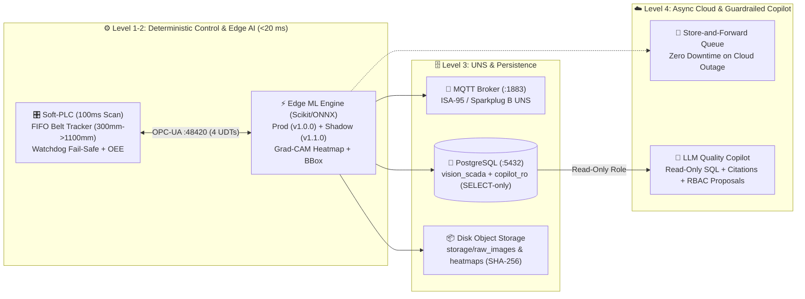

# 👁️‍🗨️ VisionSCADA AI Twin — Industrial Edge AOI, Soft-PLC, MLOps, UNS (ISA-95) & Ignition 8.3

An industrial-grade **Automated Optical Inspection (AOI) 3D Digital Twin & MLOps Platform** built outside cloud-synced folders (`C:\dev\VisionSCADA_AI_Twin`), combining a deterministic **Soft-PLC (`OPC-UA :48420`)**, **Edge ML Inference (`< 15 ms`)**, **Store-and-Forward Asynchronous Cloud Vision Auditing**, **PostgreSQL (`vision_scada`)**, **Unified Namespace (`ISA-95 / Sparkplug B MQTT :1883`)**, **SPC Attribute Control Chart (`Carta p` with Western Electric Rules)**, **Human-in-the-Loop (HITL) + Shadow Mode MLOps**, and a **Read-Only SQL Guardrailed LLM Copilot** integrated with **Ignition SCADA 8.3 Perspective**.

---

## 🏗️ System Architecture



---

## 🚀 Key Industrial Features

1. **Edge-First Deterministic Control vs. Cloud Async (*Store-and-Forward*)**:
   - The **Edge Model (`v1.0.0`)** classifies parts in **`~12–18 ms`** well inside the physical travel window (`~480 ms`) between the camera sensor (`300 mm`) and pneumatic reject cylinder (`1100 mm`).
   - If Edge inference exceeds `350 ms`, the **Soft-PLC Watchdog** triggers a fail-safe reject (`REJECT_WATCHDOG`) and raises a `CRITICAL` ISA-18.2 alarm.
   - Suspect or defective frames are queued asynchronously to the **Cloud Vision Auditor (`~850 ms`)** with full **Store-and-Forward buffering** if internet connectivity drops.
2. **Multi-Recipe Selector (3 Datasets = 3 Dynamic 3D Meshes + 6 Trained Models)**:
   - `CAST_100`: Metallic cast-iron pump impellers (`OK`, `Porosity_Pinhole`, `Shrinkage_Crack`, `Flash_Burr`).
   - `PACK_200`: Back-lit pharmaceutical glass vials & capsules (`OK`, `Neck_Crack`, `Liquid_Contamination`, `Seal_Deformation`).
   - `PCB_300`: 4-layer SMT electronic boards (`OK`, `Copper_Short`, `Open_Trace`, `Mousebite_Spur`).
3. **4 Ignition SCADA UDTs (`ignition/vision_scada_udts_and_tags.json`)**:
   - `UDT_ConveyorAxis`, `UDT_VisionCamera`, `UDT_RejectActuator`, `UDT_ProductionBatch`.
4. **SPC Carta $p$ + Western Electric Rules & ISA-18.2 Alarm Pipeline**:
   - Real-time subgroup calculation of $p_i$, $\bar{p}$, $\text{UCL} (3\sigma)$, and automatic evaluation of Western Electric rules (`RULE_1_3SIGMA`, `RULE_2_2OF3_2SIGMA`, `RULE_4_RUN_ABOVE_MEAN`).
5. **Closed-Loop MLOps (Human-in-the-Loop, Shadow Mode & Optical Drift PSI)**:
   - Compare `v1.0.0 (PRODUCTION)` against `v1.1.0-shadow (SHADOW)` in real time, re-label parts from the HMI (`human_feedback`), and promote Shadow to Production (`RBAC: ML_Engineer`).
6. **Guardrailed Read-Only SQL Copilot (`copilot_ro`)**:
   - Connects to PostgreSQL using a strictly `SELECT`-only database role, cites every SQL query executed, and emits RBAC-gated setpoint recommendations requiring human confirmation.

---

## ⚡ Quick Start

```powershell
cd C:\dev\VisionSCADA_AI_Twin
.\.venv\Scripts\python.exe ignition_sync.py
.\.venv\Scripts\pytest.exe -v
.\.venv\Scripts\python.exe server.py
```

- **Main 5-View SCADA & MLOps Console**: `http://127.0.0.1:8020`
- **Standalone 3D Three.js AOI Vision Cell (realistic PBR, `static/cell3d_v2.html`)**: `http://127.0.0.1:8020/cell3d`
- **Legacy low-poly 3D cell**: `http://127.0.0.1:8020/cell3d/legacy`
- **Printable / PDF Shift Quality Report**: `http://127.0.0.1:8020/report`
- **Soft-PLC OPC-UA Endpoint**: `opc.tcp://127.0.0.1:48420/visionscada/plc/`
- **Ignition Perspective View**: `Perspective -> Views -> Celda_Vision_AOI_MLOps`

### 🎥 Realistic 3D cell (`/cell3d`)

- three.js r170 is vendored in `static/vendor/three/` (no internet needed on the OT network or inside the Ignition iframe).
- PBR materials with procedural textures (epoxy floor, slotted aluminium profiles, rubber belt, cast iron, glass vials, PCB), factory-hall image-based lighting, 5000 K overhead panels, soft shadows, GTAO ambient occlusion, bloom and SMAA.
- Parts follow the Soft-PLC FIFO (`pos_mm`, camera 300 mm → pusher 1100 mm), are pushed down the chute into the reject tote and pile up there (mirrors `Bin_Count`), OK parts drop into the OK tote.
- Quality toggle (button or `Q`): *Alta* (GTAO, 2048 shadows, glass transmission) / *Baja*; it auto-downgrades below ~28 FPS. `R` toggles auto-orbit.
- Optional `.glb` overrides in `static/models/`: `conveyor.glb`, `vis_gantry.glb`, `reject_pusher.glb`, `part_impeller.glb`, `part_vial.glb`, `part_pcb.glb`.
